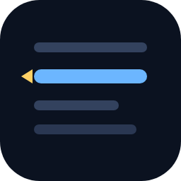
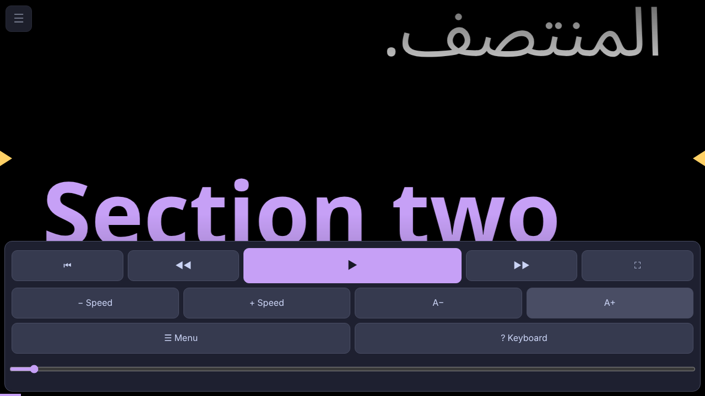
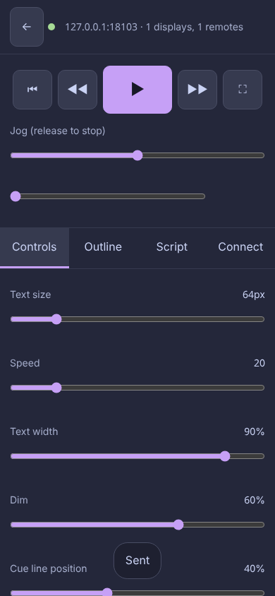
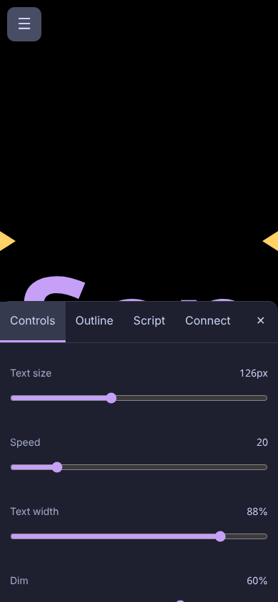
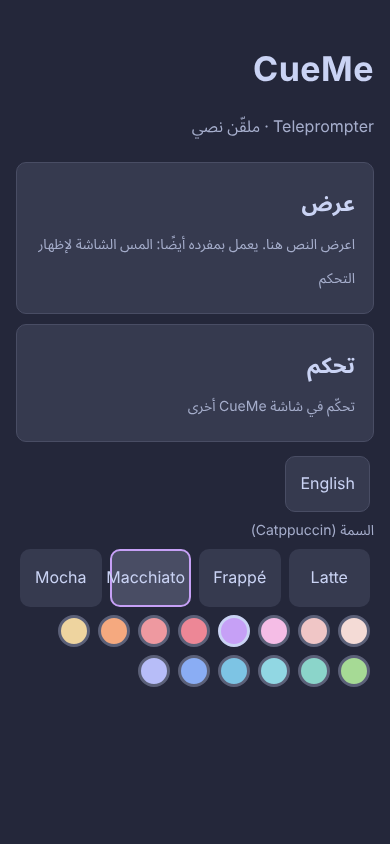

# CueMe

**A free teleprompter where every device is both the screen and the remote.**
Arabic + English, Linux and Android (even Android 6), no cloud, no account.

## Why CueMe

- **Any device can be the screen** (laptop, tablet, an old phone) and **any device can be the remote**, or the same one. Android on the display and Linux as the remote? Or the opposite? Both work.
- **Arabic and English together**: each paragraph lays out in its own direction. The Arabic UI is mirrored, and the app ships with good fonts (Noto Naskh Arabic UI, Roboto, JetBrains Mono for code).
- **Smooth, live scrolling**: the remote always shows where the screen really is; dragging the slider glides instead of jumping.
- **Jump around fast**: an outline of all headings, next/previous heading, and keys 1-9.
- **Four Catppuccin themes** (Latte, Frappé, Macchiato, Mocha) with 14 accent colours.
- **Private**: it all runs on your own network. Nothing goes to the internet.

&nbsp;

&nbsp;

## Download

Get everything from the **[Releases page](https://github.com/mmBesar/CueMe/releases)**.

| You have | Download |
|---|---|
| Linux PC / laptop (amd64, arm64) | `CueMe-linux-<arch>.AppImage`, or the `.deb`, or the `cueme-desktop-linux-<arch>.tar.gz` |
| Linux riscv64 | `cueme-linux-riscv64.deb` or `cueme-desktop-linux-riscv64.tar.gz` (and the AppImage when it could be built) |
| Android 8 or newer | `CueMe-android-modern.apk` |
| **Android 6 / 7** | `CueMe-android6.apk` |
| Server / Raspberry Pi / no screen | `cueme-serve-linux-<arch>` (one file) or the Docker image (see below) |

**Linux notes.** The apps are built on current systems, so use a recent distribution (Debian 13, Fedora 44, Ubuntu 26.04, NixOS 26.05 and newer). The `.deb` and the tarball need the system packages `libwebkit2gtk-4.1-0` and `libgtk-3-0`; the AppImage carries its own. The window icon on Wayland desktops (Hyprland, Plasma, Noctalia...) comes from `cueme.desktop`: the `.deb` installs it, and the AppImage / plain binary create it in your own `~/.local/share` the first time they start (set `CUEME_NO_INTEGRATION=1` to prevent that; delete the two `cueme` files there to undo it).

**Android.** Open the APK on the phone and allow "install from this source" once.

## Docker (the web version of CueMe)

The Docker image is the **same app** as the desktop one, served as a web page. Run it on a server, a NAS or a Raspberry Pi, then open it from any browser.

1. Save [`docker-compose.yml`](docker-compose.yml) in a folder and run `docker compose up -d`.
2. Read the PIN: `docker compose logs cueme` (a line like `PIN: 123`).
3. Open **`http://<the-machine-ip>:7878`** on any device and type the PIN.

Good to know:
- **Port 7878.** Scripts you save go to `./scripts`, settings and the PIN to `./config`.
- **Many devices at once.** Every browser that opens the page chooses **Display** or **Remote** for itself, so a phone can be the screen while a tablet and a laptop are remotes. They all share one script.
- **Works with the apps.** The desktop and Android apps find the Docker hub in their *Nearby* list (that is why the compose file uses host networking), or you can scan its QR code / type its address. An app can be a remote for the Docker hub, or show its script.
- No automatic discovery needed? Remove `network_mode: host` and use the `ports:` line in the file.

Without compose: `cueme-serve` (the single file) does the same on any Linux box.

## Using it

### Three ways to use it
1. **Stand-alone**: tap **Display**. The screen has everything: tap it to show the control bar (play/pause, previous/next heading, top, fullscreen, speed, text size, a position slider, the menu). Nothing else is needed.
2. **Display + remote**: one device shows, another controls. Tap **Display** on one and **Remote** on the other.
3. **Browser remote**: any phone or computer browser can open the address shown on the display and act as a remote, with nothing installed.

### Fullscreen without any buttons
Fullscreen (the ⛶ button, `F`, `F11`, or from the remote) shows **only the script**. Stray taps do nothing. A small see-through dot sits in the corner: tap it and the control bar comes back for a few seconds. Outside fullscreen, a single tap on the screen shows or hides the bar. `Esc` leaves fullscreen.

### Scrolling by hand
Drag the text with a finger or the mouse (the auto-scroll waits while you hold, then carries on; a quick flick glides on), or use the mouse wheel. On the display, tap-drag works in portrait and landscape; the menu opens as a bottom sheet in portrait so the script stays visible above it.

### Connecting a remote
Open the **Connect** tab in the display's menu: it shows a QR code, the address and a **PIN (up to 3 digits)**.
- **Nearby**: every CueMe announces itself on the Wi-Fi (UDP broadcast, works on Android 6 and Android 16). On the remote, tap **Remote** and pick the display from the list, then type the PIN.
- **Scan QR**: on the remote, tap **Scan QR** and point the camera at the display's code. It connects by itself (Android needs the camera permission, asked once).
- **Type it**: address like `192.168.1.20:7878` and the PIN.

If a Wi-Fi blocks broadcast (some guest networks), use the QR code or type the address.

### Jumping around a long script
- **Outline** tab: every heading of the script. Tap one and the display glides there (works from the remote too).
- **Position slider**: drag anywhere; far jumps take about two seconds, short ones are gentle.
- **Previous / next heading** buttons (or PageUp / PageDown on the display).
- **Jog slider**: push for slow or fast scrolling, let go and it stops.

### Scripts: where they are saved and how to reload them
Write or paste text in the **Script** tab (Markdown). **Send to display** shows it, **Clear** empties the script (on the display and in the box), **Save** stores it. Send and Clear sit above the text box, so the phone keyboard never hides them. The **Library** list shows every `.md` / `.txt` file in the display's script folder; tap a name to load it. The folder path is printed under the list. To reload after copying files into the folder by hand, save any script or reopen the Script tab.

| Where | Script folder |
|---|---|
| Linux app | `~/Documents/CueMe` (or `CUEME_LIBRARY`) |
| Android | the app's own folder `Android/data/app.cueme/files/scripts` (on Android 11+ file managers hide `Android/data`; use a PC over USB, or the Library list in the app) |
| Headless hub / Docker | `--library DIR` (default `~/.local/share/cueme/scripts`) / the `/scripts` volume |

### Controls
Text size, speed (lines per minute), text width, dim, cue-line position, mirror (flip X), flip Y, bold, colours, focus band, countdown, fullscreen on play, **Use theme colours for the script**, and the **script font** (Roboto + Noto Naskh Arabic UI by default, or Noto Sans Arabic, or the system font; all bundled with the app, chosen per device).

Press `?` (or `F1`) in the app for this list.

| Key | Action |
|---|---|
| Space / K | play / pause |
| Up / Down | scroll while held |
| Left / Right  or  `,` `.` | slower / faster |
| `+` / `-`  or  Alt + Up / Down | text size |
| `[` / `]` | text width |
| PageUp / PageDown | previous / next heading |
| `1`-`9` | jump to heading number N |
| Home / T,  End | top, bottom |
| R | stop and go to the top |
| F / F11 / Alt+F | fullscreen (from a remote: `F` = the display, `Alt+F` = this window) |
| Esc | close the menu, then leave fullscreen |
| C | show / hide the control bar |
| M, O, E | menu, outline, edit script |
| X, Y, B, D | mirror, flip vertically, bold, focus band |
| Ctrl+Q | quit (desktop app) |

Shortcuts also work on an Arabic keyboard layout (they follow the physical key).

## Android: installing updates
APKs from the Releases page install and update normally. If you ever see "app not installed" when updating, the new file was signed with a different key than the one on your phone: uninstall the old one first (your scripts live in the folder shown in the Script tab, not inside the app).

## Security
- Devices connect with a PIN of **up to 3 digits**: easy to type, but weak by design. Treat CueMe as a tool for a network you trust (your home or studio Wi-Fi, or Tailscale). **Never port-forward it to the internet.**
- Wrong guesses are rate-limited per address. Web pages from the internet cannot talk to a hub on your machine (requests with a non-local `Origin` are refused).
- Scripts are converted to HTML by the Rust core; raw HTML is shown as text, unsafe links and images are dropped, and a content-security-policy backs that up, so a script cannot run code. Links in a script are text only.
- Traffic on the LAN is plain HTTP/WebSocket.

## Known limits
- **Android 6 uses the phone's system WebView**, updated through Google Play. If the UI looks broken on an old phone, update "Android System WebView". QR scanning needs a WebView recent enough for the camera; if not, the button is hidden and the nearby list / typing still work.
- If Arabic dots or marks look misplaced on a Linux system, pick another script font in the Controls tab (it is chosen per device).
- The Android app stops serving when Android closes it in the background. Keep it open while prompting (the screen is kept awake).
- In a plain browser, fullscreen from the remote needs a tap on the display first (browsers insist). The apps do it directly.
- riscv64: the AppImage is a thin one (needs `libwebkit2gtk-4.1` installed).

## For developers and maintainers
Building, releasing and signing the Android apps: see **[MAINTAINING.md](MAINTAINING.md)**.

## Third-party
[jsQR](https://github.com/cozmo/jsQR) (Apache-2.0) reads QR codes; Catppuccin colours are from the [Catppuccin](https://catppuccin.com) palette (MIT); fonts are Noto, Roboto and JetBrains Mono (SIL OFL). Details in [`THIRD_PARTY.md`](THIRD_PARTY.md).

MIT licence, © mmBesar.
